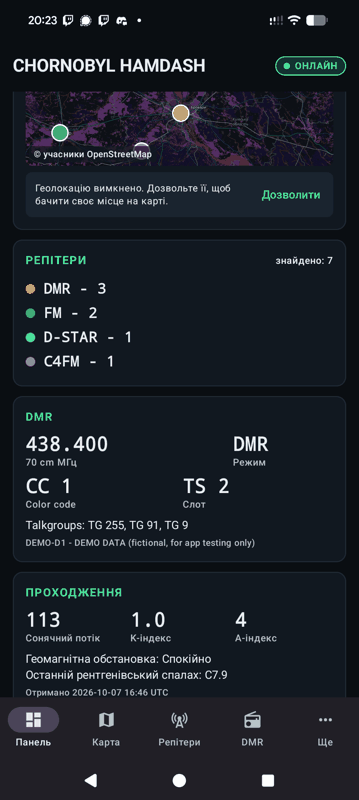
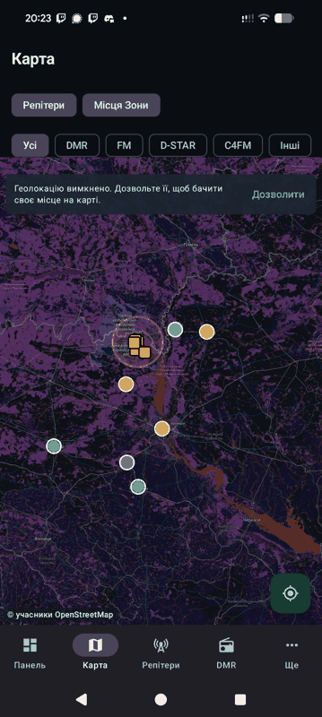
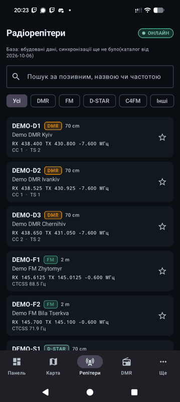
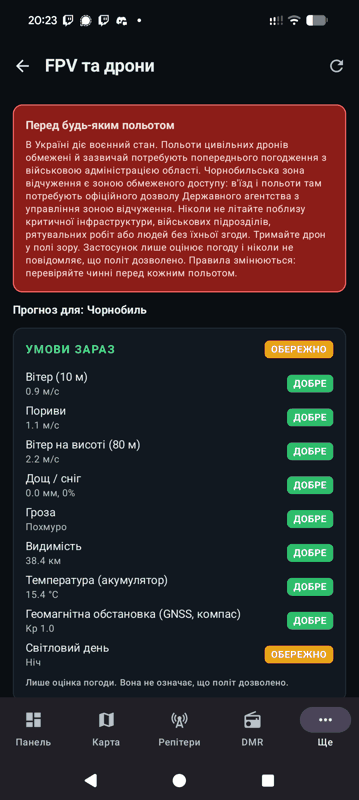
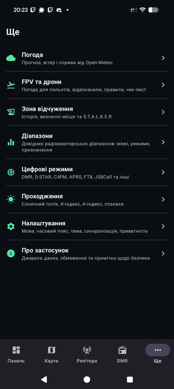

# Chornobyl HamDash

Native Android dashboard for licensed radio amateurs working in the Chornobyl region, in the spirit of HamClock.
It collects public amateur radio information in one place: repeaters (DMR, FM, D-STAR, C4FM), DMR parameters and
talkgroups, a band reference, a digital mode reference, UTC and local clocks with sunrise and sunset, basic
propagation data, a map, a weather forecast with a drone flight weather rating, an FPV reference (5.8 GHz video
channels, control links, checklist, legal notice), and the history and public landmarks of the Exclusion Zone with
clearly labeled S.T.A.L.K.E.R. game references. Everything saved works offline.

It is not a navigator and is not intended for military use. See "Safety limits" below.

| Dashboard | Map | Repeaters | FPV | More |
| --- | --- | --- | --- | --- |
|  |  |  |  |  |

## Build and run

Requirements: JDK 17 or newer, Android SDK with platform 35 (Android Studio installs both).

```bash
./gradlew :app:testDebugUnitTest      # JVM unit tests
./gradlew :app:assembleDebug          # app/build/outputs/apk/debug/app-debug.apk
./gradlew :app:installDebug           # install on a connected device or emulator
```

Or open the folder in Android Studio and press Run. A GitHub Actions workflow (`.github/workflows/build.yml`)
builds the APK and runs the tests on every push.

Minimum Android 8.0 (API 26), target and compile SDK 35.

## Languages

The interface is available in English and Ukrainian (Settings > Display > Language). On first launch the app follows the
device language (Ukrainian if the device is set to Ukrainian, English otherwise). Strings live in
`app/src/main/res/values/strings.xml` and `values-uk/strings.xml`; to add a language, add a `values-<code>/strings.xml`,
an entry in `settings/AppLanguage.kt`, and a `fastlane/metadata/android/<code>/` folder.

Reference content that comes from the catalog (band purposes, digital mode descriptions, talkgroup descriptions and source
names) is shown as stored in the catalog data, so the bundled catalog texts are in English.

## Stack and layout

Kotlin, Jetpack Compose, Material 3, coroutines and Flow, ViewModel, Room, DataStore, Retrofit and OkHttp,
kotlinx.serialization, osmdroid (OpenStreetMap, no API key). Architecture: MVVM with a repository.

```
app/src/main/java/com/hamdash/chornobyl/
  domain/     models, filters, sun calculator, formatting (no Android dependencies)
  data/       RadioDataRepository implementation, Local/Remote data sources, catalog parser and validator
  database/   Room entities, DAOs, database
  network/    Retrofit RawApi, NOAA parsers, connectivity monitor
  location/   LocationTracker (platform LocationManager, no Google Play services)
  settings/   DataStore settings
  ui/         theme, navigation, screens and ViewModels (dashboard, map, repeaters, dmr, more, settings)
app/src/main/assets/catalog.json   bundled offline catalog
```

## Data sources

The app never invents values. Missing data is shown as `NO DATA`, and every repeater and talkgroup shows its source.

| Data | Source |
| --- | --- |
| Repeaters, talkgroups | Bundled `catalog.json`. **The bundled repeaters are fictional demo entries marked `DEMO DATA`.** Replace them with a real public source. |
| Bands, digital modes | Bundled general reference (IARU Region 1 overview, official project sites). Always check your national allocation plan. |
| Propagation | NOAA SWPC public JSON (`services.swpc.noaa.gov`): 10.7 cm flux, planetary K and A index, latest X-ray flare. |
| Weather | Open-Meteo forecast API (`api.open-meteo.com`, no key, CC BY 4.0): current conditions, 3-day hourly and daily forecast, wind at 10 m and 80 m. |
| Zone history, landmarks, game notes | Bundled `zone.json`, compiled from Wikipedia and IAEA articles. Every entry carries its source; only public civilian and historical landmarks. Game notes are labeled as fiction. |
| Map | OpenStreetMap tiles through osmdroid, cached on the device. The default public OSM tile server is meant for light use; set your own https tile URL in Settings > Map tiles for heavier use. |

### Plugging in a real source

`RadioDataRepository` talks to a `LocalDataSource` (Room) and a `RemoteDataSource`. The bundled implementation,
`HttpCatalogRemoteDataSource`, downloads a catalog JSON from the https URL entered in Settings > Data source.
Refresh flow: fetch, parse and validate, store the valid sections in Room, otherwise keep the local data, and show the
time of the last sync. To use a different API, implement `RemoteDataSource` and pass it in `AppContainer`.

Catalog format (`schemaVersion` 1), see `app/src/main/assets/catalog.json` for a full example:

```json
{
  "schemaVersion": 1,
  "updated": "2026-10-06",
  "repeaters": [{
    "id": "unique-id", "name": "...", "callsign": "...",
    "rxMHz": 438.4, "txMHz": 430.8, "mode": "DMR",
    "colorCode": 1, "timeslot": 2, "talkgroups": [255],
    "lat": 50.45, "lon": 30.52, "elevationM": 180,
    "source": "where this entry comes from", "lastUpdated": "2026-10-06"
  }],
  "talkgroups": [], "bands": [], "digitalModes": []
}
```

`rxMHz` is the frequency you listen on (repeater output), `txMHz` the frequency you transmit on (repeater input).
Invalid entries are skipped and reported; entries without a `source` are rejected. A section with no valid entries
never replaces the stored one.

## Author

Yevhen "CUBE" Honchar

## License

GPL-3.0-or-later, see `LICENSE`. Change it before the first public release if you prefer another free license
(also update `fdroid/com.hamdash.chornobyl.yml`).

## Publishing on F-Droid

F-Droid builds the app from source, so nothing is uploaded. The repository is public, the `v0.1.0` and `v0.2.0` tags
exist, and `fdroid/com.hamdash.chornobyl.yml` passes `fdroid lint` against the current fdroiddata categories.

1. Create a GitLab account and fork https://gitlab.com/fdroid/fdroiddata.
2. In the fork, add `metadata/com.hamdash.chornobyl.yml` with the content of `fdroid/com.hamdash.chornobyl.yml`
   (the comment lines at the top can be dropped).
3. Open a merge request to fdroiddata titled "New app: Chornobyl HamDash" and fill in its template. The CI pipeline
   on the merge request runs lint and a test build; answer reviewer questions there.
4. Before that, it is worth replacing the bundled demo repeaters with real public data (see "Data sources"):
   reviewers may ask why the catalog holds only demo entries.

Store texts, the icon and screenshots live in `fastlane/metadata/android/` (en-US, uk and ru-RU; screenshots are in
en-US, which F-Droid uses as the fallback for every language). For a new version: bump `versionCode` and
`versionName`, add `changelogs/<versionCode>.txt` in each language, add a `Builds` entry to the F-Droid metadata,
and publish the release (it creates the `v<version>` tag).

## Privacy

GPS feeds the map, distance labels and sun times. It is sent anywhere only if you pick "My location" as the weather
place, and then rounded to 0.1 degree (about 10 km) before the request to Open-Meteo. The default weather place is the
town of Chornobyl. Permission is requested only when you tap something that needs it, and "Show my location" can be
turned off in Settings.

## Safety limits

Not implemented on purpose: interception of private communications, decoding of protected systems, key recovery,
searching for military frequencies, detection of military sites, tracking of people, and sharing of the user's
position without consent. The map shows only public civilian and historical landmarks. The drone section rates the
weather only; it never says a flight is permitted and points to martial-law and Exclusion Zone access rules. Use only
public, lawful amateur radio data and transmit only where your license allows it.

## Status

The pure Kotlin logic (domain, flight rating, catalog, Zone and weather parsers, NOAA parsers) is covered by JVM unit tests. Version 0.2.0 has been installed and
checked on a real Android phone.
